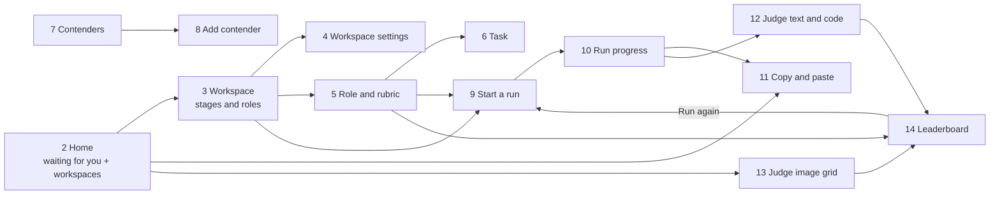

# Audition — Phase 1 design

Nov 6, 2026 · Design thread · builds on `docs/SPEC.md` (lean Phase 1) and `docs/NOTES.md`

This folder holds the Phase 1 screens as clickable wireframes, the design tokens, a starter stylesheet and the icon sprite. T4 (UI) builds the real screens from these. The wireframes themselves are plain HTML, CSS and JavaScript with no build step, so anyone can open them.

**How this fits the UI build.** Architecture (PR #3) settled on Arrow.js core for the app: reactive state and `html` templates, bundled by Bun, with a small hash router. No Tailwind, Vite or component library. In that setup:

- `tokens.css` and `app.css` are the styling system. Arrow templates use these class names and `data-state` attributes as they are.
- `icons/sprite.svg` is inlined once in the page shell; templates write `<svg class="i"><use href="#i-done"/></svg>`.
- `wireframes.js` is reference behaviour, not app code. Its pieces (dropdown, popover placement, toasts, star input, segmented thumb, live run updates) become small Arrow components with the same markup and classes.

| File | What it is |
| --- | --- |
| `wireframes.html` | All 15 screens in one page, including a state-system reference. Pick a screen from the bar at the top, or follow the links. |
| `wireframes.js` | A tiny hash router plus the interactions worth feeling. Sample data only. |
| `tokens.css` | Colour, state, type, spacing, shape and motion tokens, light and dark. |
| `app.css` | Shared components built only on the tokens. T4 can start from it. |
| `icons/` | The Phosphor icon sprite (74 icons), the script that builds it, and Phosphor's MIT licence. |

**To view:** open `wireframes.html` in a browser straight from the folder. Use the Theme picker to check dark mode, and narrow the window (or use a phone) to see the phone layout.

## Round 3 changes (Nov 6, 2026)

Cas's feedback on v2: not a fan of the burgundy, replace native selects, less rounded corners, and a Home page that pulls people in.

- **Brand: Monochrome.** Near-black actions on pure greys, white actions in dark mode. Cas went Cobalt, then Denim, then picked Monochrome on Nov 6, 2026. Colour now only carries meaning: gold for stars and champions, **violet for "waiting for you"** (Cas asked that it stand out), and one colour per state. Queued moved from purple to slate so it does not compete with waiting. To rebrand later, change only the `--accent*` tokens.
- **Selects.** Every `<select class="select">` is upgraded to a styled dropdown: a button showing the value with its icon or avatar, and a menu of options with icons, one-line descriptions, group headings and a tick on the selected one. Arrow keys, Home/End, type-ahead, Enter and Escape all work. The native select stays hidden underneath so forms keep their value, and it is styled too in case the script doesn't run.
- **Corners.** Radius now runs 4 / 6 / 8 px (chips and avatars / buttons and inputs / panels and popovers). Pills remain only for counts, dots and switches.
- **Home.** A hero greets you and says what's waiting, with one button to pick up the next task. Next to it, **Your cast** shows the champions and how many roles are cast. Below that: one large **Up next** card, a short **Also waiting** queue, workspace cards with a progress ring for roles cast and the contenders involved, a **Who plays which role** list (the routing table), and a **Latest** activity feed. The feed reads the audit log, which Phase 1 already has.

## Direction (v2)

Cas asked for a more modern look that feels less generic, with micro-interactions, more icons, richer states and extra detail tucked into popovers, so both technical and non-technical people want to use it.

- **The audition stage.** One brand accent (velvet in v2, denim in v3, monochrome now) marks what you can act on, and violet marks what is waiting for you. Gold (the spotlight) is kept for merit only: stars, the champion and the confetti when you confirm one. Neutrals are pure greys.
- **Type with character.** Bricolage Grotesque for headings and big numbers, Instrument Sans for everything else. Both are SIL OFL; the app vendors the woff2 files so it makes no third-party calls. The wireframe loads them from Google Fonts for review only.
- **Every state looks different** in colour, icon and motion (see the state system below and screen 15).
- **Calm by default, detail on demand.** AI reasons, contender settings, output tokens and cost, error details and the fitness breakdown sit behind small info buttons that open popovers.
- **Motion with a job.** Each animation confirms something happened or shows something is alive. Nothing moves for decoration, and `prefers-reduced-motion` turns movement off while keeping the state changes.

## Libraries: what we looked at

### Basecoat UI (basecoat-css 1.1.0): not adopted

Basecoat is a vanilla HTML/CSS/JS port of shadcn/ui, MIT licensed, and it does avoid React. It doesn't fit Audition for four reasons:

1. **It brings Tailwind.** The prebuilt CSS is compiled Tailwind v4 (about 83 KB uncompressed) and expects Tailwind class names in the markup. Customising beyond its theme variables means adding a Tailwind build step, which our "no frameworks" rule rules out.
2. **It looks like shadcn/ui.** That look is now the default for AI-generated apps, which is the thing Cas wants to move away from.
3. **It is young.** 1.0 shipped on June 27, 2026, with breaking markup changes across the betas and 1.0, and it has a single maintainer. We'd be pinning to a moving target.
4. **Its popover isn't native.** Basecoat's popover needs its own JS. The browser now has the `popover` attribute and `<dialog>` built in, with light dismiss, focus handling and Escape for free.

What we took from it: the data-attribute variant pattern, native `<dialog>`, and `@starting-style` enter transitions. These are platform features, so we use them directly.

### Phosphor Icons (@phosphor-icons/core 2.1.1): adopted, vendored

- MIT licence, about 1,500 icons in six weights. The package has been stable since March 2024.
- The SVGs use `fill="currentColor"` and a 256×256 viewBox, so they take colour from text.
- We use three weights on purpose: **regular** for interface chrome, **fill** for states (check, error, warning, lock, crown), and **duotone** for empty states. The filled and duotone weights read friendlier than thin line icons, which helps non-technical users.
- `icons/build-sprite.mjs` reads only the 74 icons we use from the unpacked npm package and writes `sprite.svg` plus `icons.js`. Both files are committed, so Phosphor is never a runtime dependency. The page uses `<svg class="i"><use href="#i-done"/></svg>`.
- We compared Lucide (ISC, line-only). Phosphor wins on the filled and duotone weights, which our state system relies on.

### Platform features used instead of a library

| Need | Native feature |
| --- | --- |
| Popovers with light dismiss | `popover` attribute and `popovertarget` |
| Modal image view | `<dialog>` with `showModal()` |
| Enter and exit animation | `@starting-style`, `transition-behavior: allow-discrete` |
| Card-style checkboxes | `:has(input:checked)` |
| Tooltips on icon buttons and disabled controls | CSS `[data-tip]::after`, no JS |
| Toasts | about 15 lines of JS |

These work in current Chrome, Edge, Safari and Firefox. Popover positioning is a few lines of JS; CSS anchor positioning can replace it once every browser supports it.

## State system

Each state has its own colour tokens (`--active`, `--active-bg`, `--active-line`, and so on), an icon, and a motion. Chips use ``.

| State | Icon | Motion | Used for |
| --- | --- | --- | --- |
| Draft | dashed circle | none | Not started, not rated yet |
| Queued | hourglass | turns every few seconds | Lined up for judging |
| Active | spinner | spins; progress bar shimmers | Running, being judged |
| Waiting for you | pulsing dot | breathes | Paste a reply, judge a task |
| Done | check circle | pops in once | Judged, submitted, rated |
| Warning | triangle | none | Same-provider judge, weights not 100, suggested champion |
| Error | x circle | pops in once | Failed output; details in a popover |
| Locked | lock | none | Used tasks and contenders |
| Disabled | prohibit, 45% opacity | none | Not possible yet; a tooltip says why |
| Champion | crown, gold | crown bounce and confetti on confirm | Confirmed best per role |

"Waiting for you" has its own violet so it is the one bit of colour that says "your turn" on a mostly grey page; its buttons stay in the black accent.

## Micro-interactions

- **Buttons** press down slightly; arrows nudge right on hover; the settings cog turns; primary buttons show a spinner while saving, then a toast.
- **Stars** lift on hover, pop when clicked and throw a few gold sparks. The score flashes when it changes, and the best output gets a gold outline that moves as you change stars.
- **Copy prompt** turns into a green "Copied" tick, flashes the prompt box and moves the step tracker on. Pasting a reply counts the words and enables Submit.
- **Segmented controls** slide their selection thumb. Checkbox cards pop their tick.
- **The run screen** fills its progress bar on arrival and finishes one output live, so you can see what realtime updates will feel like.
- **Making a champion** bounces the crown, throws confetti and shows a toast.
- **The waiting count** bumps when you submit an output.
- **Screens** rise in, and lists and cards stagger in.

## How the screens connect

## Screens

Each screen uses the reference workspace content from the spec, so the wireframes also check that the seed data reads well.

| # | Screen | Job | Popovers |
| --- | --- | --- | --- |
| 1 | Sign in | One owner account; the code field shows only when two-step sign-in is on. | |
| 2 | Home | Hero with greeting and Your cast, then Up next, Also waiting, workspaces with rings, Who plays which role, and Latest. | |
| 3 | Workspace | Numbered stages, role cards with champion, suggestion or progress. This is the routing table. Recent runs below. | |
| 4 | Workspace settings | Stages (reorder), default judge, AI judge, outputs needed, fitness weights with a live bar and a "needs 100" warning. | Why a minimum |
| 5 | Role and rubric | Criteria with weights, a weight bar that updates as you type, pass mark, tasks with a read-only chip. | Pass mark |
| 6 | Task | Opens read-only; **Duplicate and edit** turns it into an editable version 2. | |
| 7 | Contenders | Connections with status, contenders with avatars and state. | Key stays hidden; full contender settings |
| 8 | Add contender | "Audition calls it" or "I copy and paste"; the form and hint change to fit. | Temperature |
| 9 | Start a run | Card checkboxes, live output and call counts, same-provider warning, Start disabled until something is picked. | How calls are counted |
| 10 | Run progress | Live bar, legend, one table per task with a state for every output. | Output tokens, time, cost; error details |
| 11 | Copy and paste | Three-step tracker: copy, paste into the tool, paste the reply back (files, optional tokens and time). Submit confirms inline. | |
| 12 | Judge text and code | Blind banner, rubric, outputs A–D side by side with the agent's claims, screenshots and stars. **Change stars** to override. | The AI's reason per criterion |
| 13 | Judge image grid | Square image cards, stars under each, rated/in progress/not rated per card, a progress bar. | |
| 14 | Leaderboard | Champion card with **Make champion**, table with likely range and fitness bars. | Likely range; fitness breakdown |
| 15 | State system | Every state chip, button variants and the loading skeleton. | |

## Decisions made in this thread

For Cas to confirm in the PR. None of them adds scope; they decide how existing Phase 1 behaviour looks.

- **Brand:** Monochrome, with violet for "waiting for you" (decided Nov 6, 2026).
- **Visual direction:** one brand accent, gold for merit, crisp 4/6/8 px corners, styled dropdowns, Bricolage Grotesque and Instrument Sans (vendored), Phosphor icons (vendored). No Basecoat, no Tailwind.
- **Image-judging grid (answers the spec's open question).** One square card per output, four across on a laptop and one per row on a phone. Each card shows the first image with its letter, a "3 images" tag when there are more, and opens large on tap. Stars sit under the image. The rubric is shown once above the grid.
- **Judging on a phone.** One output per screen, swipe or tap A–D to move.
- **"Waiting for you" on Home** (with a count in the top bar) is the main way into handoffs and owner judging. It uses data Phase 1 already has.
- **The run screen hides outputs and scores** to keep judging blind.
- **Agent claims are visibly separate**, in a dashed amber box labelled "The agent's own claim. Audition didn't check it."
- **AI reasons sit behind popovers** on the judging screen, so four columns stay readable.
- **Contender avatars** are coloured monograms, so people recognise contenders at a glance. Blind outputs use plain black letter tiles instead.
- **Read-only tasks open read-only**, with one button to make a new version.

## Notes for T4

- Screens map to hash routes in the wireframe (`#home`, `#run`, ...), which matches the small hash router Architecture chose for Arrow.js.
- The dropdown, popovers and dialog rely on the native `popover` attribute and `<dialog>`, so the Arrow components only need to render markup and wire events.
- `JUDGE_DATA` in `wireframes.js` shows the shape the blind endpoint needs: letter, text, files, AI stars and reasons. No contender fields.
- The call count assumes **one AI judging call per output**. If Architecture judges a whole task in one call, `countRun()` changes.
- Star inputs are five radio buttons, so they work with a keyboard and screen readers.
- Inputs hidden with `position: absolute` need a positioned parent (`.seg`, `.star-input`, `.check` have one), or they escape scroll containers and widen the page on phones.
- To change the icon set, edit the list in `icons/build-sprite.mjs` and rerun it against the unpacked `@phosphor-icons/core@2.1.1` package.

## Open questions

- **AI judging call count:** one call per output, or one per task? It changes the number on the Start a run screen. (Architecture)
- **Images for the AI judge:** if the AI judge can't see images, Marketing's Image maker role should default to "Me". (Architecture, already open in the spec)
- **"Likely range" wording** in place of "confidence range": confirm or change.
