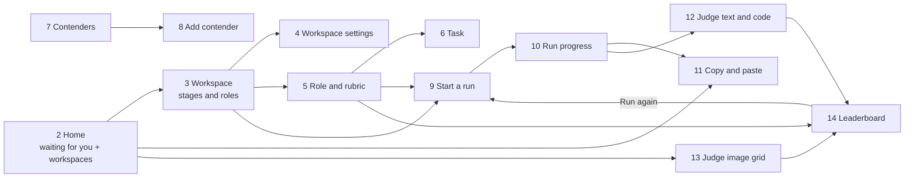

# Audition — Phase 1 design

Nov 6, 2026 · Design thread · builds on `docs/SPEC.md` (lean Phase 1) and `docs/NOTES.md`

This folder holds the Phase 1 screens as clickable wireframes, the design tokens and a starter stylesheet. T4 (UI) builds the real screens from these. Everything is vanilla HTML, CSS and JavaScript with no dependencies and no build step.

| File | What it is |
| --- | --- |
| `wireframes.html` | All 14 screens in one page. Pick a screen from the bar at the top, or follow the links. |
| `wireframes.js` | A tiny hash router plus the interactions worth feeling: copy prompt, change stars, live call count, duplicate and edit, confirm a champion. Sample data only. |
| `tokens.css` | Colour, type, spacing and shape tokens, light and dark. |
| `app.css` | Shared components built only on the tokens. T4 can start from it. |

**To view:** open `wireframes.html` in a browser straight from the folder. Use the Theme picker to check dark mode, and narrow the window (or use a phone) to see the phone layout.

## Principles

1. **Plain words.** Screens say "outputs", "Who judges: Me or AI", "Waiting for you", "Make champion". Never "attempt", "verdict" or "casting" on screen.
2. **One next step at a time.** The teal accent marks the thing to do next. Most screens have one primary button.
3. **Blind means blind.** Judging screens never show a contender's name, and the run screen never shows output text or scores, so nothing leaks before you judge.
4. **Explain the rule where it bites.** Read-only tasks, the call count, why tokens were left out of fitness: each is explained in one sentence on the screen where it matters.
5. **Phone first for the simple paths.** Copy, paste, rate and confirm all work at 375 px. Editing rubrics is easier on a laptop but still works on a phone.

## How the screens connect

The main loop is the spec's: tasks, then runs, then judging, then a champion per role.

## Screens

Each screen uses the reference workspace content from the spec, so the wireframes double as a check that the seed data reads well.

| # | Screen | Job | Spec |
| --- | --- | --- | --- |
| 1 | Sign in | One owner account; the code field appears only when two-step sign-in is on. | Users |
| 2 | Home | **Waiting for you** lists outputs to paste back and tasks to judge, each with one button. Below it, the workspaces with their champion count. | Run flow |
| 3 | Workspace | Stages as columns, roles as cards. Each card shows its champion, or "Suggested", or how far it is from enough data. This is the routing table. Recent runs below. | Casting |
| 4 | Workspace settings | Name, stages (reorder), default judge, AI judge contender, outputs needed for a champion, and fitness weights that must add up to 100. | workspaces |
| 5 | Role and rubric | Description (goes into every prompt), rubric rows with weight and guidance, a weight bar, pass mark, usual output type, and the role's tasks. | roles |
| 6 | Task | Opens read-only when the task has been used, with **Duplicate and edit** making version 2. Code tasks show repository and commit. | tasks, read-only rule |
| 7 | Contenders | Connections (keys are never shown again, only replaced) and every contender with model, settings, token limit, prices, and whether it is used. | connections, contenders |
| 8 | Add contender | First question: "Audition calls it (API)" or "I copy and paste". The form changes to fit. Prices sit in a closed "optional" section. | contenders |
| 9 | Start a run | Role, tasks, contenders, who judges. A summary box counts outputs and provider calls live, and says how many prompts you'll copy. Warns when the AI judge shares a provider with a contender. | Spending guard |
| 10 | Run progress | One table per task with each output's state, tokens and time. "Paste output" on the ones waiting for you. A failed output says why in a sentence. **Run again** once everything is in. | Attempt lifecycle |
| 11 | Copy and paste | Three numbered steps: copy the prompt, paste it into the tool, paste the reply back (plus files, plus optional tokens and time). Submitting asks once, inline, because it can't be undone. | Handoff |
| 12 | Judge text and code | Rubric once at the top, then outputs A, B, C, D side by side. Each shows the text, the agent's own build/test/lint claim in a dashed box, screenshots, and stars per criterion with the AI's reason. **Change stars** overrides; the AI's stars stay in history. | Judging |
| 13 | Judge image grid | Square image cards in a grid with stars below each. Tap to enlarge. See the image-grid decision below. | Judging |
| 14 | Leaderboard | Suggested champion box with **Make champion**, then the table: outputs, average, likely range against the pass mark, tokens, time, cost, fitness. A note says which fitness terms were used and why. | Leaderboard, fitness |

## Decisions made in this thread

For Cas to confirm in the PR. None of them adds scope; they decide how existing Phase 1 behaviour looks.

- **Image-judging grid (answers the spec's open question).** One square card per output, in a responsive grid: four across on a laptop, one per row on a phone. The card shows the first image with its letter, and a "3 images" tag when there are more; tapping opens a large view. Stars sit right under the image, one row per criterion. The rubric is shown once above the grid, not repeated per card.
- **Judging on a phone.** Outputs become a swipeable strip, one output per screen, with A, B, C, D buttons to jump. On a laptop they sit side by side and scroll sideways when there are more than fit.
- **"Waiting for you" on Home** (with a count in the top bar) is the main way into handoffs and Me-judging. It lists data Phase 1 already has; no new records.
- **The run screen hides outputs and scores.** It shows state, tokens and time only. That keeps owner judging and owner overrides blind.
- **Agent claims are visibly separate.** Build, test and lint results sit in a dashed box labelled "Agent's own claim, not checked by Audition", because Audition runs no checks.
- **Submit asks once, inline.** A pasted output can't be replaced, so the submit button asks "You can't change it afterwards. Use Run again for a fresh one."
- **Read-only tasks open read-only**, with one button to make a new version, instead of an edit form that refuses to save.
- **Confidence range is drawn**, as a small band with a dot for the average and a line for the pass mark, labelled "Likely range" on screen.
- **Group by model** is a checkbox on the leaderboard that regroups rows under their contender group.
- **No web fonts.** The system font stack keeps Audition at zero runtime dependencies and makes no third-party calls.

## Tokens

`tokens.css` defines every colour on `:root` for light, and again for dark under `prefers-color-scheme: dark` and `[data-theme="dark"]`, so a later theme switch works both ways. Components use tokens only.

- **One accent (teal)** for primary actions, links and the current place.
- **Amber is only for stars.** Nothing else uses it, so ratings stand out.
- **State colours** (ok, waiting, failed, warning) are separate from the accent and always paired with a word, never colour alone.
- **Type scale** 12 / 14 / 16 / 20 / 26 px. Inputs are 16 px so phones don't zoom.
- **Spacing** on a 4 px grid; touch targets at least 44 px for the main actions.

## Notes for T4

- Screens map to hash routes in the wireframe (`#home`, `#run`, ...). T4 picks its own routing; nothing here requires hash routing.
- The judging data in `wireframes.js` (`JUDGE_DATA`) shows the shape the blind endpoint needs: letter, text, files, AI stars and reasons. No contender fields.
- The run builder's call count assumes **one AI judging call per output**. If Architecture judges a whole task in one call, the formula in `countRun()` changes.
- Star inputs are five radio buttons, so they work with a keyboard and screen readers without extra code.
- Absolutely positioned hidden inputs need a positioned parent (`.seg`, `.star-input` have `position: relative`), or they escape scroll containers and widen the page on phones.

## Open questions

- **AI judging call count:** one call per output, or one per task with all outputs? It changes the number on the Start a run screen. (Architecture)
- **Images for the AI judge:** if the AI judge can't see images, Marketing's Image maker role should default to "Me". The image grid works either way. (Architecture, already open in the spec)
- **"Likely range" wording:** the spec calls it a confidence range. "Likely range" is plainer; confirm or change.
